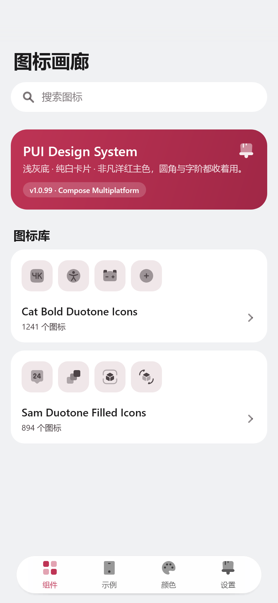
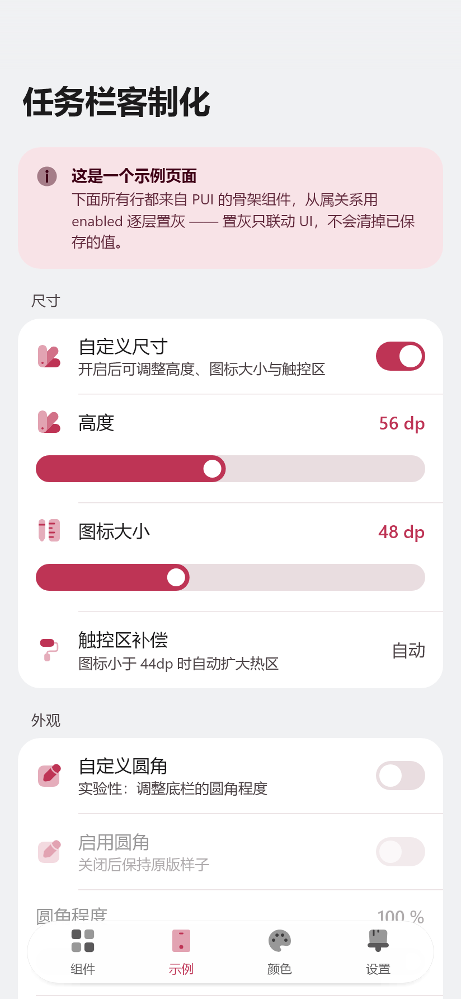
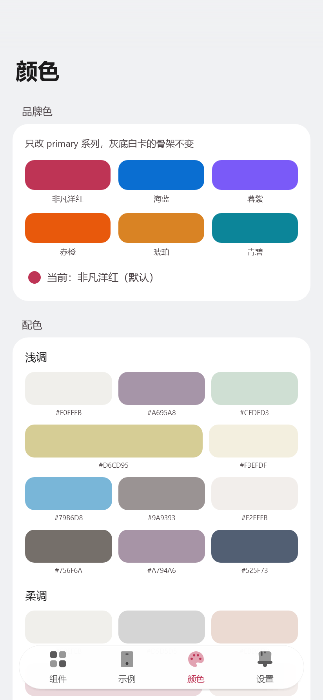
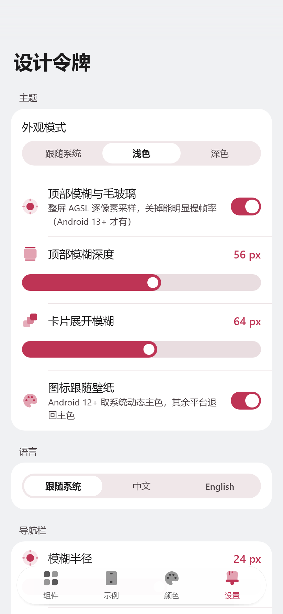
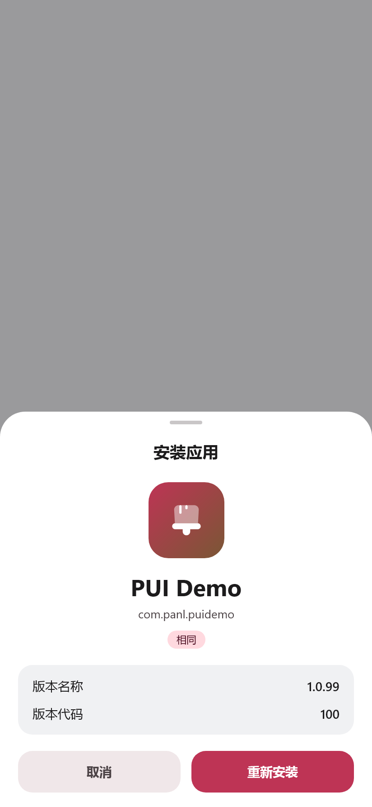
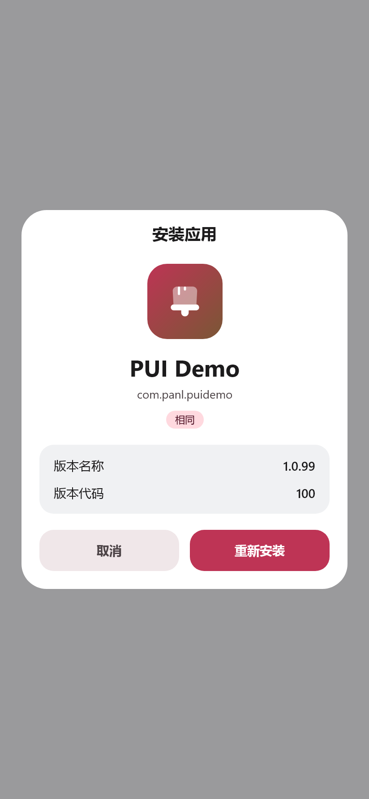
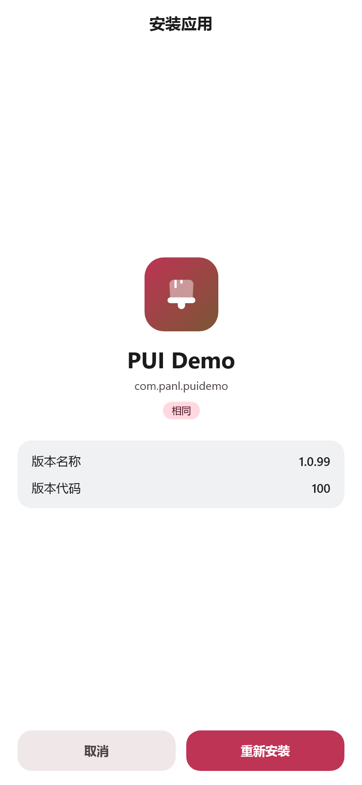
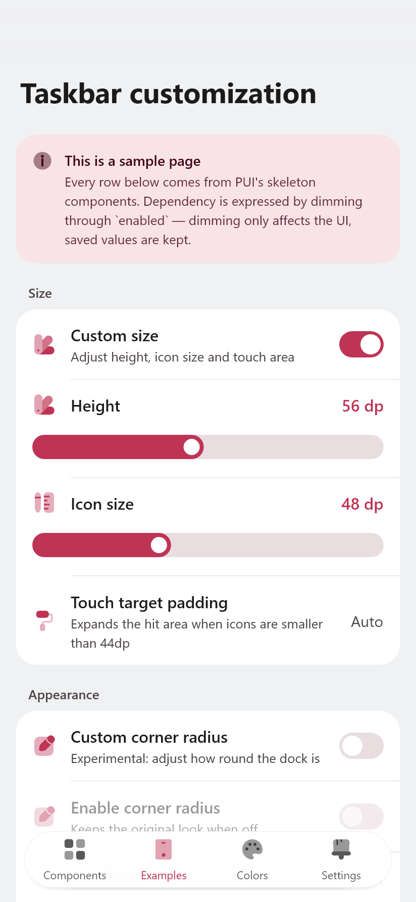

# PUI Demo

[](https://github.com/sakurakingfifth-debug/pui-demo/actions/workflows/ci.yml)
[](LICENSE)
[](https://kotlinlang.org)
[](https://www.jetbrains.com/compose-multiplatform/)
[](#)

PUI 设计系统的**演示 App**：把主题、令牌、图标、卡片、行、控件按展柜的方式铺开，
改完样式直接跑起来对照。用 Compose Multiplatform 写，一份 `commonMain` 同时出 Android APK 和桌面预览。

视觉基调：**浅灰底 + 纯白卡片 + 非凡洋红（PANTONE 18-1750 Viva Magenta，`#BE3455`）主色**，圆角克制（卡片 20dp）、字阶克制，
接近 ColorOS 原生设置页，而不是 Material 3 Expressive 那种「大字大圆角」。

## 截图

四个页面（浅色）：

| 组件 | 示例 | 颜色 | 设置 |
|---|---|---|---|
|  |  |  |  |

底部浮窗的三种形态：

| 底部下沉 | 居中 | 全屏 |
|---|---|---|
|  |  |  |

英文界面：



> 以上都是 `./gradlew :composeApp:renderPreview` 离屏渲染出来的，不是真机截图。

---

## 一、跑起来

需要 JDK 17+（本机用的是 Android Studio 自带 JBR 25）、Android SDK（compileSdk 37 / targetSdk 37）。

```bash
# Android APK
./gradlew :composeApp:assembleDebug
# 产物：composeApp/build/outputs/apk/debug/composeApp-debug.apk

# 桌面预览（改样式时用它，比装 APK 快）
./gradlew :composeApp:run

# 离屏出图（不弹窗）：page0/1/2 + page0-dark + page0-full 长图
./gradlew :composeApp:renderPreview
# 产物：composeApp/build/preview/*.png
```

> 首次构建需要联网拉 Compose Multiplatform 的桌面运行时（skiko，约 30 MB）。
> JDK 版本不一致时，用 `JAVA_HOME` 指到 Android Studio 自带的 JBR 即可。

---

## 二、四个页面

| 页面 | 内容 | 什么时候看它 |
|---|---|---|
| **组件** | 概览卡 / 图标库（2 套、2000+ 图标）/ 浮窗 | 改单个组件的样子 |
| **示例** | 一个真实的「任务栏客制化」设置页：三级从属置灰 + 安装面板（含形态设置） | 改完组件后看组合有没有崩 |
| **颜色** | 品牌色板（六个预设 + 调色盘）+ 配色预览 | 调品牌色时看 |
| **设置** | 主题切换（深浅 / 壁纸取色）+ 语言 + 模糊参数 + 四张令牌表 | 改主题参数 |

底部是原版悬浮胶囊导航栏（整条可拉伸回弹 + 毛玻璃），顶部有渐进模糊（Android 13+）+ 渐隐遮罩。

---

## 三、目录结构

```
PuiDemo/
├── composeApp/src/
│   ├── commonMain/kotlin/com/panl/pui/        ← 组件库（跨平台，改这里）
│   │   ├── PuiTheme.kt        配色 / 字阶 / 形状 / PuiTheme 入口 / 品牌色覆盖
│   │   ├── PuiPlatform.kt     平台差异的 expect 声明（取色 / 触感 / 系统栏 / 模糊）
│   │   ├── PuiIcons.kt        46 个手绘 duotone 图标
│   │   ├── PuiComponents.kt   开关 / 滑块 / 分段 / 标签 / 按钮 / 输入框 / 进度 / 勾选 / 头像
│   │   ├── PuiRows.kt         页面骨架：分组、开关行、滑块行、列表行、单选行、勾选行
│   │   ├── PuiCards.kt        卡片家族：白卡 / 描边卡 / 提示卡 / 数据卡 / 应用卡 / 强调卡
│   │   ├── PuiNav.kt          悬浮胶囊导航栏（弹跳/拉伸 + 毛玻璃蒙版）+ 顶部渐隐
│   │   ├── PuiFeedback.kt     对话框 + 轻提示
│   │   └── PuiSheet.kt        底部浮窗（圆角面板 + 拖拽手柄 + 标题栏），背后由调用方压暗模糊
│   ├── commonMain/kotlin/com/panl/puidemo/    ← 演示 App
│   │   ├── App.kt             外壳：Pager + 导航栏 + 主题状态
│   │   ├── Strings.kt         中英文案目录（按页面分组）+ LocalStrings
│   │   └── screens/           组件画廊 / 示例页 / 颜色页 / 令牌页
│   ├── androidMain/           MainActivity + 平台实现（AGSL 模糊、动态取色、触感）
│   └── desktopMain/           桌面入口 + 平台实现（空实现）
└── gradle.properties          见下方「构建注意」
```

---

## 四、改样式的入口

| 想改什么 | 改哪里 |
|---|---|
| 品牌色 | `PuiTheme.kt` 的 `PuiMagenta` / `PuiLightColors` / `PuiDarkColors` |
| 卡片圆角 | `PuiShapes.large`（20dp）——所有卡片、提示卡都走这一档 |
| 字阶 | `PuiTypography`（只覆盖实际用到的档位） |
| 行高 / 内边距 | `PuiRows.kt` 里各行的 `padding(horizontal = 16.dp, vertical = 14.dp)` |
| 开关尺寸 | `PuiSwitch` 的 `trackW / trackH / knob / inset` |
| 滑块 | `PuiSlider` 的 `trackHeight` / `thumbSize` 参数（默认 24dp 轨道 + 16dp 圆钮，见 `PuiSliderStyles.Pui`） |
| 图标 | `PuiIcons.kt` 的 `drawPuiIcon`，加一个 enum 分支即可 |
| 导航栏 | `PuiNav.kt` 的 `PuiBarMetrics`（56dp 高 / 88dp 单格 / 6dp 内边距）与 `GLASS_FILL_*`（玻璃底色，alpha 就是模糊可见度） |
| 浮窗 | `PuiSheet.kt` 的 `PuiSheetShape`（顶部 28dp 圆角）/ `PuiSheetDismissThreshold`（下拉 96dp 关闭） |

### 浮窗（bottom sheet）

从屏幕底部长上来的圆角面板，背后压暗 + 实时高斯模糊。和对话框的分工：
**对话框问一个问题，浮窗展开一块内容。**

```kotlin
val progress = remember { Animatable(0f) }          // 由宿主持有
Box(Modifier.puiRealtimeBlur(progress = { progress.value }, maxRadius = 20.dp)) { 页面 }
if (open) {
    PuiSheet(
        progress = { progress.value },
        onDismiss = { close() },                     // 遮罩 / 下拉 / 返回键都走这里
        header = { PuiSheetHeader("标题", onClose = { close() }, showClose = false) }
    ) { /* 内容 */ }
}
```

三个必须注意的点：

1. **模糊不能由浮窗自己加**。`RenderEffect` 只作用于节点自己的子树，浮窗里加只会把浮窗糊掉。
   要让背景糊，必须由宿主持有进度、把 `puiRealtimeBlur` 加在**页面内容**上，浮窗只读同一个进度。
2. **浮窗必须挂在外壳（`App.kt`）而不是页面里**。放进 `HorizontalPager` 的某一页，
   会被导航栏盖住 —— 它是模态层，本来就该压在导航栏之上。
3. **模糊进度铺满后不能归零**。图标集是整屏覆盖，铺满后可以撤掉模糊省性能；
   浮窗只盖下半截，上半截一直露着，归零就会「面板一到位背景突然变清晰」。

**标题栏默认只有居中标题**（`PuiSheetHeader(showClose = false)`）。关闭入口已经够多——
贴底有手柄下拉 / 点遮罩 / 返回键 / 底部「取消」，全屏有返回键和底部动作；
再放一个 × 只是重复，右上角那种装饰性齿轮没有真实动作，更不该占位。
需要时才打开 `showClose` / 传 `actionIcon`。

### 三种安装形态

示例页「安装」卡片里切的是**默认形态**，同一张卡上方的「安装应用」按它渲染：

| 形态 | 落点 | 动效 | 模糊 |
|---|---|---|---|
| 浮窗 | `PuiSheetPosition.Bottom`（默认） | 从屏幕下方上滑，带拖拽手柄、可下拉关闭 | 有 |
| 浮窗 | `PuiSheetPosition.Center` | 从中心 92% 放大 + 淡入，四角全圆、无手柄 | 有 |
| 全屏 | — | 整页淡入 + 96% 放大，顶部返回栏 + 底部动作栏 | **无**（整屏不透明，糊了也看不见，白烧一遍全屏高斯） |

居中之所以不接下拉手势：居中弹层没有「往下拖走」的隐喻，硬接会和「缩放进来」的进场动作对不上。
内容三段（身份卡 / 信息卡 / 动作）在三种形态间复用，见 `screens/InstallSheet.kt`。

演示入口在**示例页**的「安装」卡片：上面一行 `安装应用` 点开面板，下面就是形态与落点的两个分段控件。
放在这里而不是组件页，是因为它是一次真实的安装交互，不是一个组件标本；
形态开关紧挨着入口，改完能立刻点开看效果。

### 多语言

界面文案全部走 `commonMain/.../puidemo/Strings.kt`，**不依赖 compose-resources**：

- `PuiStrings` 按页面分组（`nav` / `gallery` / `example` / `tokens` / `color` / `install` /
  `iconSheet` / `iconSet` / `picker` / `common` / `enums`），中英各一份实例 `PuiZh` / `PuiEn`；
- `LocalStrings` 是 `staticCompositionLocalOf`，在 `App()` 里按语言注入 —— 换语言整屏即时生效，不用重启；
- 「跟随系统」用 `androidx.compose.ui.text.intl.Locale.current.language`，Android 和桌面同一套代码；
- 设置页「语言」分组只有一行入口，点进去是**独立语言页**（`screens/LanguageScreen.kt`）：
  每项一行、显示本族名 + BCP-47 标签。语言一多，分段控件会挤成看不清的小格子，所以单独成页。
- 目前 5 种：简体中文 / 繁體中文（台灣）/ 繁體中文（香港）/ English / 日本語，选择落盘（`language`）。
  繁中两套是分别写的，不是简转繁 —— 只转字形不改用词，读起来会是「大陆人写的繁体」。
- 加一门语言 = 在 `Strings*.kt` 里加一个 `PuiStrings` 实例 + 枚举加一项，界面不用动。

**加一条文案**：`Strings.kt` 里两个实例各加一个字段，名字必须一致（少一个编译不过）。
带参数的写成 `(Int) -> String` 而不是 `%d` 占位符 —— 拼错编译期就报。

**组件库不做语言假设**：`PuiSheetPosition` / `ThemeMode` / `InstallStyle` 这些枚举都不带 `label`，
显示名由 `Strings.kt` 的 `themeModeLabels()` 之类按语言取；`PuiSearchBar` 的 `placeholder` /
`cancelText` 也由调用方给。这样库本身是中性的，换语言不用改库。

---

## 五、加东西的步骤

**加一个图标**

1. `PuiIcon` 加枚举值；
2. `drawPuiIcon` 的 `when` 里加分支，用文件里的 `rr / disc / ring / bar / tri / star / path` 原语拼；
3. 遵守构造规则：纯实心、主形 100%（`main`）+ 辅助形 45%（`sub`）、无描边、24×24 网格。
4. 演示页的 `label()`（`screens/UiUtil.kt`）补个中文名。

**加一个组件**

1. 组件放 `PuiComponents.kt`（控件）或 `PuiCards.kt`（容器）；
2. 尺寸、颜色、圆角全部取 `MaterialTheme.*`，不要写死；
3. 在 `screens/GalleryScreen.kt` 或 `GallerySections.kt` 里加一节，让它在演示页可见。

**加一个页面**

1. `screens/` 下新建，签名建议 `(topPad: Dp, onToast: (String) -> Unit)`；
2. `App.kt` 的 `rememberPagerState { 3 }` 改成 4，`when (page)` 加分支，导航栏 `items` / `icons` 同步加。

**发版本**

每次迭代 `+0.0.1`，两处都要改（没有构建期注入）：

1. `AppInfo.VERSION`（首页徽标、「令牌 → 关于」卡片显示用）；
2. `composeApp/build.gradle.kts` 的 `versionCode`（+1）/ `versionName`（装包用）。

---

## 六、构建注意（踩过的坑）

1. **AGP 9 与 KMP 冲突**：AGP 9.0 起 `com.android.application` 与 `kotlin("multiplatform")`
   不允许同模块共存，会直接报 `not compatible ... since AGP 9.0`。
   `gradle.properties` 里已经加了绕过开关：
   ```properties
   android.builtInKotlin=false
   android.newDsl=false
   ```
   哪天 AGP 再收紧，就改成官方推荐的双模块结构（`:shared` 用
   `com.android.kotlin.multiplatform.library`，`:androidApp` 用 `com.android.application`）。

2. **`local.properties` 里的 SDK 路径是本机的**，换机器要改：
   ```properties
   sdk.dir=C:/Users/<you>/AppData/Local/Android/Sdk
   ```

3. **模糊需要 Android 13+**（AGSL `RuntimeShader` + `RenderEffect`）。低于该版本
   `puiProgressiveTopBlur` 直接返回原 Modifier，不崩；同时 `PuiPlatformSupportsBlur = false`，
   导航栏的玻璃底会自动从 70% 不透明切到 98%，避免背后文字直接透出来。

4. **桌面端没有系统能力**：壁纸取色、触感、系统栏高度、AGSL 模糊全部是空实现。
   观感与 Android 一致，只有这四项不同。

### 16 KB 页对齐

Android 15 起有 16 KB 页的设备；targetSdk 35+ 上架时，APK 里每个 `.so` 必须同时满足：

1. 以**不压缩**方式存进 ZIP（`method=0`）；
2. 数据在 ZIP 里的偏移是 **16384** 的整数倍；
3. ELF 每个 `PT_LOAD` 段的 `p_align ≥ 0x4000`。

缺任何一条，16 KB 机器上 `dlopen` 直接失败 —— 而 4 KB 机器上一切正常，属于最难查的回归。

本项目的处理：

- `packaging { jniLibs.useLegacyPackaging = false }` 显式写死（AGP 8.5.1+ 默认就是 false，
  写死是为了防止哪天被改回去）；
- 自检任务 `verify16kbPageSize`，挂在 `assembleDebug` / `assembleRelease` 的 `finalizedBy` 上，
  每次打包自动跑，不通过直接让构建失败：

  ```
  > Task :composeApp:verify16kbPageSize
  16 KB 页对齐检查通过：8 个 .so（composeApp-debug.apk, composeApp-release.apk）
  ```

  它自己解析 ZIP 中央目录 + ELF 程序头，不依赖 `zipalign` 或 NDK 工具链。

当前只有 `libandroidx.graphics.path.so`（Compose UI 的传递依赖）一个原生库，四个 ABI，
本身已经是 16 KB 对齐的。**以后加带 `.so` 的依赖时**，这个检查会兜住；
真要自己编 native 代码，得用 NDK r28+ 并以 16 KB 对齐编译。

手动复核（可选，需要 SDK build-tools）：

```bash
zipalign -c -P 16 -v 4 app-debug.apk   # 末尾应输出 Verification successful
```

### 性能约束（改之前先看）

这套界面在真机上的帧率主要被两件事影响，都已经处理过，改动时别退回去：

1. **长页面用 `LazyColumn`**。组件页的图标库一节有 2000+ 个图标、每张卡还要渲染 4 个预览，
   全量组合一次要几十毫秒，进页面和切标签都会卡一下；Lazy 只组合可视区域。
2. **`HorizontalPager` 的 `beyondViewportPageCount = 1`**，预组合相邻页，
   否则滑页中段要从零组合一整页。

**顶部模糊的采样数按半径走：顶端 8+16=24 次，往下线性递减到 8 次；NavBar 胶囊固定 14 次。**
1.0.72 之前是顶部固定 48 次、胶囊 32 次，在 144Hz 屏（帧预算 6.91ms）上 GPU 要 9.8ms，
是界面卡顿的主因；降到现在这组数后 GPU 约 6.3ms，整帧 p90 从 15.3ms 降到 8.7ms，
28dp 半径下看不出颗粒感。**再往上加采样数会直接掉帧，要调就同一构建背靠背 A/B 对比。**

**NavBar 的毛玻璃改在同一个 AGSL 里算，不再用 RenderEffect 的 blend 链。**
原版是 `blur → 蒙版 DST_IN → 与原图 SRC_OVER` 三段拼出来的，问题在于同一个 `base`
节点既进了 `createBlurEffect` 又进了 `createBlendModeEffect`——RenderEffect 图里一个节点
只能被消费一次，部分设备上整条链会静默失效，表现是「顶部糊了、NavBar 底下却是清的」。
现在胶囊区域直接在 shader 里用圆角矩形 SDF + 螺旋采样算，边缘 1px 羽化，行为一致且没有节点复用问题。

真机嫌卡就用令牌页的「顶部模糊与毛玻璃」开关整体关掉（不挂 RenderEffect，导航栏玻璃转不透明）。

另外：`PuiCard` 不要再套 `clip()`（Card 自己按 shape 裁了），多余的一层就是一个图层。

---

## 七、和原 `PuiTheme`（Android AAR）的差异

| 项 | 原版 | 这里 | 原因 |
|---|---|---|---|
| 平台 | 仅 Android | Compose Multiplatform（Android + 桌面） | 桌面端能秒看效果 |
| 壁纸取色 | `PuiTheme` 内直接调 `dynamicLightColorScheme` | 抽成 `rememberWallpaperAccent` expect/actual | 桌面没有该 API |
| 滑块几何 | 24dp 轨道 + 16dp 圆钮，两端各留 3dp，已选段包到「圆钮 + 4dp」 | **同规格**：24dp + 16dp，两端留 4dp（= (24−16)/2），已选段包到「圆钮中心 + 12dp」 | 原版 3dp 端距配 4dp 包裹，0% 时环一边 3dp 一边 4dp（用户反馈「左右边距不一样」）；统一成 4dp 后是标准同心圆环 |
| 滑块置灰 | 只有数值变色 | 整行减淡到 0.45 | 和 `PuiSwitchRow` 的置灰语义对齐，不然看着还能操作 |
| 图标数量 | 11 个 | 46 个（原 11 个逐点保留） | 演示页需要成组的图标 |
| 图标细节 | `Touch` / `Warning` 用「实心 + 45% 叠色」 | 改成 EvenOdd 圆环 / 浅色底 + 实心符号 | 45% 同色叠在不透明实色上合成出来还是实色，三层看不出来（`Touch` 渲染成了纯色圆、`Warning` 的叹号消失） |
| 单选 | — | 内点比外环小 3.5dp | 否则内外同色连成一片，看着像实心圆 |
| 导航栏 | 完整实现（弹跳 / 拉伸 / 毛玻璃 / 触点光效） | **原样移植**；蒙版与 `RenderEffect` 落在 androidMain 的 actual | 跨平台：桌面没有 RenderEffect，靠 `PuiPlatformSupportsBlur` 切不透明玻璃 |
| 导航栏明暗判定 | `isSystemInDarkTheme()` | `colorScheme.background.luminance()` | 演示页可以在 App 内切深浅，不能跟系统走 |
| 导航栏触感 | `HapticFeedbackType.TextHandleMove` | `rememberTickHaptic()`（CLOCK_TICK） | 和库里滑块的触感约定保持一致 |
| 新增 | — | 分段控件、标签、按钮族、输入框、进度、勾选、单选、头像、卡片族、对话框、轻提示 | 演示页要覆盖「各种样式」 |

原来的 11 个图标、配色、字阶、圆角、开关、行骨架**数值完全一致**，
从 `PuiTheme` 迁过来的页面观感不会变。

---

## 八、许可证与素材

代码以 **MIT** 发布，见 [LICENSE](LICENSE)。

`composeApp/src/*/resources/icons/` 下的图标（`icons_solar.txt`、`icons_iconsax.txt`，
共 2000+ 条路径数据）与 `PuiIcons.kt` 里的 46 个手绘图标**均为本项目作者绘制**，
随项目一同以 MIT 发布，可自由使用、修改、再分发。

图标数据是纯文本路径（`名称|透明度@SVG path|...`），没有位图资源，
所以仓库里不涉及字体或图片的授权问题。
